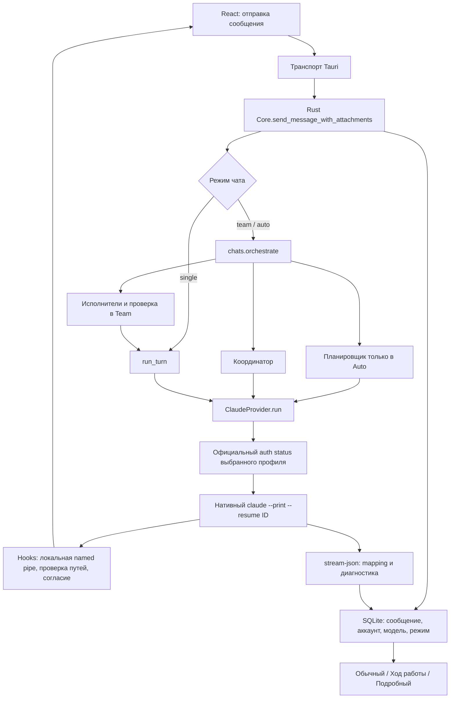

# Почему BebekonCode запрашивает доступ и расходует лимит Claude

Дата: 14 октября 2026. Аудит существующего рабочего дерева, содержащего незакоммиченные
изменения до начала этой работы. Ниже отдельно отмечены исправления этого аудита и уже
существовавшее поведение. Пользователь выбрал проверки **без расхода лимита**.

## Основные выводы

1. Повторные подтверждения shell и MCP заложены в адаптере намеренно. В Windows он не
   предоставляет песочницу ОС для этих инструментов. `PreToolUse`, `PermissionRequest` и
   явные `ask`-правила требуют согласия на каждый вызов. `workspace_auto` означает
   **acceptEdits для файлов проекта**, а не полный доступ и не официальный Auto mode.
2. В команде действительно создаются дополнительные вызовы: исполнитель, иногда взаимная
   проверка, координатор; в Auto ещё и планировщик. Это не один обычный разговор Claude Code.
3. Найдено лишнее повторение текущего запроса. В первом командном ходе он попадал в исходную
   цель, последнюю реплику, исторический текст, общее задание и задание исполнителя. Исправлено.
4. Обычный чат уже использует официальный CLI, собственную сессию и `--resume`. Самодельного
   цикла вызовов LLM вместо Claude Code нет. Переход на Node Agent SDK ради исправления этих
   проблем технически не требуется и изменил бы действующий способ подписочной интеграции.
5. Утверждение о расходе в 2–5 раз больше **не подтверждено**. Различие числа запусков,
   повторные байты контекста, токены и проценты подписки — разные величины.

## Реальный путь запроса

Ключевые файлы: `src/App.tsx`, `src/transport.ts`, `crates/agent-core/src/runtime.rs`,
`crates/agent-core/src/chats.rs`, `crates/agent-core/src/claude/{mod,guard,mapping,access}.rs`.
Tauri остаётся транспортом; провайдер и оркестрация находятся в Rust core.

Исполнение: установленный официальный нативный Claude Code, минимальная версия адаптера
2.1.293. Точная версия на компьютере определяется `--version`; этим аудитом она не
сертифицируется. Agent SDK 0.3.295 закреплён в devDependencies для служебных задач/контрактов,
но не заменяет нативный CLI при обычном запуске чата.

Авторизация: каждый аккаунт имеет `CLAUDE_CONFIG_DIR`; вход/выход выполняет CLI. Учётные
данные не извлекаются из других клиентов. Промпт отправляется по stdin; изображения —
нативными image-блоками, другие вложения — через ограниченное локальное представление.
Обычный запрос не содержит вручную склеенную полную историю поверх `--resume`.

## Подтверждённые проблемы и изменения

| Приоритет | Причина / место                                                                                              | Что изменено                                                                                                    |
| --------- | ------------------------------------------------------------------------------------------------------------ | --------------------------------------------------------------------------------------------------------------- |
| Высокий   | `chats::shared_context`, `orchestrate`: текущий TurnStarted уже находился в истории при составлении промптов | Текущий run исключён из исторического контекста; сообщение и вложения передаются явно                           |
| Высокий   | `orchestrate`: текст задачи повторялся в PlannedTask и в общей инструкции исполнителя                        | Повтор удалён; роль и задача сохранены                                                                          |
| Высокий   | `runtime::run_turn`: ошибка сохранения provider_session_id только логировалась                               | Запуск прекращается с `session_persistence`, без автоматической повторной отправки                              |
| Высокий   | `guard::manual_decision`: временное разрешение привязывалось к чату и файлу, без аккаунта                    | Ключ теперь аккаунт + чат + канонический путь; передача чата другому профилю не переносит разрешение            |
| Средний   | `ClaudeProvider::release_account`: выход из одного профиля очищал разрешения всех                            | Отзываются только разрешения выбранного аккаунта                                                                |
| Средний   | `guard::manual_decision`: старое разрешение могло автоматически ответить на неожиданный запрос в acceptEdits | Неожиданный PermissionRequest остаётся интерактивным                                                            |
| Средний   | `mapping::StreamState`: повторные UUID/ID инструментов создавали повторный текст/карточки                    | Добавлено ограниченное окно дедупликации по ID; одинаковый текст с разными ID сохраняется                       |
| Средний   | `shared_context`: накопление большого текста до окончательной обрезки                                        | Накопитель ограничивается в ходе свёртки истории, с сохранением отдельно извлечённых цели и последней коррекции |
| Средний   | `Timeline`: фильтр «Действия агента»/поиск мог скрыть ожидающее разрешение                                   | Активный запрос остаётся видимым; его нельзя спрятать режимом детализации                                       |
| Средний   | Расход показывался агрегатом без привязки каждого запуска к профилю                                          | Добавлены отдельные числовые диагностические отчёты успешных, ошибочных и остановленных запусков                |
| Удобство  | Одно представление действий и открытые длинные блоки                                                         | Три локальных режима, сворачиваемые действия, подгрузка по 100 действий, сохранение выбора                      |
| Удобство  | Снимки изменений были видимы только у последнего сообщения                                                   | Старые снимки доступны и подписаны «За это сообщение»; это история счётчиков, не сохранённые патчи              |
| Удобство  | «Авто» и временное разрешение можно было понять как бессрочный полный доступ                                 | Уточнены область, срок действия и фактический режим Claude; при создании команды показано число запусков        |

## Проверка гипотез

«Исключено» означает исключено в проверенном пути приложения и покрытых сценариях, а не
гарантию отсутствия любых ошибок у провайдера. «Требует проверки» не означает найденный дефект.

### Сессии и повторная отправка

| Гипотеза                                                   | Статус                           | Основание                                                                                          |
| ---------------------------------------------------------- | -------------------------------- | -------------------------------------------------------------------------------------------------- |
| Обычный чат всегда создаёт новую сессию                    | Исключено                        | `drive` передаёт сохранённый `--resume`; subprocess-тест подтверждает одинаковый upstream ID       |
| Сессия теряется после перезапуска                          | Исключено в тестах               | ID хранится в SQLite; новый Core продолжает привязанный диалог без истории в prompt                |
| Ошибка записи ID проходит незаметно                        | Подтверждено, исправлено         | Инъекция ошибки SQLite проверяет остановку, один запрос и отсутствие ложного успеха                |
| Два чата используют общий ID                               | Исключено в тестах               | У каждого Session свой ID; проверяются отдельные потоки и аккаунты                                 |
| Resume выбирает другой аккаунт                             | Исключено в проверенном пути     | Проверка account_profile_id и отдельный CLAUDE_CONFIG_DIR перед запуском                           |
| Каждый ответ делает fork                                   | Исключено                        | Флаг fork не передаётся; отдельной команды fork в адаптере нет                                     |
| Весь локальный диалог передаётся поверх resume             | Исключено для single             | `run_turn` добавляет context_summary только без upstream ID                                        |
| Координатор повторно получает всю историю на resume        | Уже исправлено до аудита         | В существующем рабочем дереве coordinator_context пуст при resume                                  |
| Новый исполнитель команды повторно изучает проект          | Подтверждено как архитектура     | Новая task-session для каждого сообщения; история ограничена и передаётся текстом                  |
| После ошибки автоматически создаётся другая сессия/аккаунт | Исключено                        | Ошибка видима, нет автоматического fallback аккаунта; кнопка повтора — действие пользователя       |
| Перерисовка/смена детализации отправляет запрос повторно   | Исключено в проверке UI          | Перехват sendMessage: одна отправка после нескольких переключений                                  |
| Два одновременных запроса пишут в один чат                 | Исключено в core                 | Резервирование running-сессии и запрет смены настроек во время работы                              |
| Независимые чаты одновременно меняют общую папку           | Требует организационной изоляции | Последовательность писателей обеспечивается внутри одной команды; общей блокировки репозитория нет |

### Промпты, инструменты и оркестрация

| Гипотеза                                                                      | Статус                               | Основание                                                                                                    |
| ----------------------------------------------------------------------------- | ------------------------------------ | ------------------------------------------------------------------------------------------------------------ |
| Вызван SDK без системного пресета Claude Code                                 | Исключено                            | Здесь нативный CLI; `--system-prompt` не заменяется, используется только append для выбранных навыков        |
| Текущая задача многократно повторяется                                        | Подтверждено, исправлено             | Исключение текущего run из shared_context и удаление повторного задания                                      |
| История и вложения добавляются несколькими слоями                             | Частично уже исправлено, дополнено   | Ранее убраны worker/context_summary и повторные описания вложений; теперь убрана текущая реплика из истории  |
| Каждый запуск получает описания всех интеграций                               | Исключено                            | Только выбранные навыки и разрешённый MCP; неизбирательного каталога в prompt нет                            |
| Разные инструкции, навыки и настройки относительно Desktop                    | Подтверждено                         | Restricted, пустой setting-sources, отключённые slash-команды и встроенные Agent/Skill, явный MCP            |
| CLAUDE.md загружается дважды приложением                                      | Не обнаружено                        | Приложение не склеивает CLAUDE.md вручную; фактическую загрузку конкретной версии CLI нужно сверять отдельно |
| Большие вложения/изображения увеличивают контекст                             | Возможно, требует реальных замеров   | Ограничения на размер не делают содержимое бесплатным; данные идут в выбранный запуск                        |
| Полный репозиторий автоматически анализируется перед каждым single-сообщением | Исключено на стороне приложения      | Нет отдельного скрытого анализа перед run; чтение решает CLI                                                 |
| UI вызывает модель для прогресса, оформления, названия                        | Не обнаружено                        | Режимы отображают события локально; заголовок берётся из prompt                                              |
| Дополнительные планирование/проверки/итог                                     | Подтверждено в team/auto             | Три явные точки provider.run в `run_turn`, `quiet`, `orchestrate`                                            |
| Неограниченные вложенные субагенты Claude                                     | Исключено для встроенного Agent      | Agent/Monitor запрещены; приложение ограничивает Auto четырьмя задачами и параллелизм двумя читателями       |
| Исполнители дублируют исследования друг друга                                 | Возможно                             | Роли и общая задача не гарантируют непересекающиеся исследования; нужен matched live trace                   |
| MCP возвращает огромные результаты                                            | Требует проверки конкретного сервера | Ограничение NDJSON защищает парсер UI, но не ограничивает вход модели внутри CLI                             |
| Tool result вручную повторно отправляется из Rust                             | Исключено                            | Tool loop принадлежит CLI; Rust обрабатывает согласие и события                                              |
| Ошибки инструментов вызывают бесконечный retry приложения                     | Не обнаружено                        | Нет внешнего retry-цикла; CLI имеет свои повторные попытки, запуск ограничен часом                           |
| Повторные события выполняют инструмент второй раз                             | Исключено на стороне UI              | UI не исполняет tool_use из потока; дубли карточек исправлены отдельно                                       |
| Computer use используется вместо прямого чтения файлов                        | Не доказано                          | Выбор инструмента делает агент; локальные действия требуют согласия, это не автоматическая оптимизация       |
| Каждый инструмент запускает новый Claude CLI                                  | Исключено                            | Один процесс обслуживает весь turn; отдельный процесс создаётся на следующее сообщение                       |

### Модель, кэш и измерение лимитов

| Гипотеза                                                       | Статус                                     | Основание                                                                                                        |
| -------------------------------------------------------------- | ------------------------------------------ | ---------------------------------------------------------------------------------------------------------------- |
| Более дорогая модель или высокий effort выбран пользователем   | Возможная причина                          | Настройки независимы у каждого участника; aliases могут разрешаться в другую версию                              |
| Приложение всегда принудительно ставит максимальный effort     | Исключено                                  | Передаёт выбранный effort или оставляет default CLI                                                              |
| Fast незаметно включён для всех                                | Исключено в тестах существующей реализации | Default false, отдельное подтверждение; планировщик Fast не наследует                                            |
| Субагенты наследуют неподходящую модель                        | Возможно для выбранных шаблонов            | Исполнитель получает настройки своего шаблона; отсутствие выбора другого профиля не гарантирует оптимальной цены |
| Сам CLI делает fallback модели/служебный запрос                | Требует live-проверки                      | Приложение его не добавляет; не все вспомогательные вызовы входят в usage                                        |
| Кэш отключён приложением                                       | Не обнаружено                              | Нет такой явной настройки; профиль/CLI/условия провайдера требуют отдельного измерения                           |
| Изменение контекста или порядка инструментов ухудшает кэш      | Возможно                                   | Новые task-сессии и меняющийся briefing отличаются от single; порядок списка навыков в guidance отсортирован     |
| Resume делает весь контекст бесплатным                         | Исключено как предположение                | Resume сохраняет разговор, но контекст/кэш продолжают учитываться провайдером                                    |
| Накопительный total_cost_usd сложен как стоимость каждого хода | Исключено в текущем коде                   | Эти поля не суммируются; берутся per-turn main-loop usage                                                        |
| Cache read/creation ошибочно считаются процентами подписки     | Исключено                                  | Отдельные числовые поля, без пересчёта в quota                                                                   |
| Число запусков равно числу API-запросов                        | Исключено как предположение                | Один CLI-run содержит несколько циклов; num_turns не равен полному HTTP trace                                    |
| Сумма видимых токенов описывает весь расход                    | Неверно                                    | usage не включает некоторые auxiliary/sidechain/subagent вызовы; обрыв может не дать final usage                 |
| Сопоставимые задачи расходуют в 2–5 раз больше подписки        | Не установлено                             | Нет согласованного живого эксперимента; пользователь исключил расход лимита                                      |

### Разрешения, остановка и интерфейс

| Гипотеза                                                       | Статус                         | Основание                                                                                                |
| -------------------------------------------------------------- | ------------------------------ | -------------------------------------------------------------------------------------------------------- |
| UI Auto отправляет default вместо acceptEdits                  | Исключено для workspace_auto   | Аргументы CLI и настройки проверяются subprocess-fixture, файл меняется без вопроса                      |
| Настройка применяется к уже запущенному процессу               | Не поддерживается              | Изменения заблокированы во время выполнения и применяются к следующему сообщению                         |
| Каждый новый процесс забывает выбранный профиль доступа        | Исключено                      | Профиль хранится в Session, тест после открытия новой Core-инстанции                                     |
| Разрешение «в контексте» бессрочное                            | Нет, это ограничение           | Только файл/аккаунт/чат в памяти; не постоянное правило SDK                                              |
| Выход другого аккаунта вызывает новые вопросы                  | Подтверждено, исправлено       | Очистка grants теперь избирательная                                                                      |
| Старое разрешение переносится другому аккаунту при handoff     | Подтверждено, исправлено       | В ключ добавлен account_profile_id                                                                       |
| Ask/deny/hooks сильнее общей выбранной настройки               | Подтверждено                   | Файловая защита, запрет credentials, mandatory consent shell/MCP сохраняются                             |
| Встроенные штатные Auto/Plan/Bypass доступны                   | Нет                            | UI объясняет ограничения; read_only — профиль приложения, не native Plan                                 |
| Сохранённый updatedPermissions автоматически подхватится       | Нет в restricted-пути          | CLI читает managed и --settings; простая запись projectSettings дала бы ложное обещание                  |
| Корпоративная политика или hooks влияют на разрешение          | Требует проверки среды         | Managed policy принадлежит провайдеру; адаптер не выдумывает название сработавшего правила               |
| Отмена не останавливает CLI                                    | Исключено в fixture-проверках  | CancellationToken, Windows job/process group, завершение потомков                                        |
| Закрытие вкладки отменяет работу                               | Нет по дизайну                 | Чаты выполняются независимо от видимой вкладки; для остановки есть явная команда                         |
| Остановка ядра автоматически повторяет незавершённый turn      | Исключено                      | Перезапуск помечает interrupted, не запускает запрос повторно                                            |
| История/карточки растут без ограничения DOM                    | Частично улучшено              | Ходы по 40, действия по 100 и без монтирования закрытого списка; полная история ещё хранится в памяти UI |
| Крупная история временно потребляет много RAM при handoff/team | Подтверждено, улучшено         | Ограничение накопителя в shared_context; загрузка до 5000 событий из SQLite всё ещё имеет стоимость      |
| Приватные рассуждения доступны для красивого отображения       | Не предоставляются приложением | Отображаются публичный ход работы и инструменты; thinking/signatures не сохраняются                      |

## Численные результаты без обращения к модели

Структурное сравнение первого хода команды с одним исполнителем. «До» восстановлено из
формирования промпта в исходном рабочем дереве; «после» проверено на реально собранных
`TurnRequest` в интеграционном тесте. Это **не замер токенов или подписки**.

| Метрика                                                     |                     До |                                  После |
| ----------------------------------------------------------- | ---------------------: | -------------------------------------: |
| Копии текущей задачи в первом запросе исполнителя           |                      5 |                                      1 |
| Копии текущей задачи в первом запросе координатора          |                      4 |                                      1 |
| Суммарные копии в этих двух запусках                        |                      9 |                                      2 |
| Запуски приложения: single / команда с 1 исполнителем / с 2 |              1 / 2 / 5 |                              1 / 2 / 5 |
| Дополнительные отправки при смене вида чата                 | 0 (смены вида не было) | 0: sendMessage остался вызван один раз |
| Область временного file grant                               |             чат + файл |                   аккаунт + чат + файл |
| Автоматическое продолжение при ошибке сохранения session ID |               возможно |            остановка с видимой ошибкой |
| Истинное снижение токенов, цены, лимита                     |             нет данных |                             нет данных |

Для неповторяющегося текста задачи длиной L байт удалено 7L байт именно его лишних копий
из двух промптов первого командного хода (пока он помещается в исторические ограничения).
Это не процент экономии всего контекста: остаются инструменты, инструкции, прежняя история,
результаты исполнителей и собственная работа Claude. Например, для 4000 байт задачи это
28 000 байт лишних копий; пример арифметический, не оплаченный модельный эксперимент.

Нативный CLI не заменён SDK-sidecar: расходы задаются фактической оркестрацией, а не языком
адаптера. Пять запусков не означают строго пятикратный расход — размеры контекстов различаются.

## Диагностика и поддерживаемые возможности

Панель «Расход Claude» доступна у каждого хода. В ней есть список планирования, исполнения
и сборки итога, новые/продолженные сессии, prompt_bytes и per-turn counters. Дополнительный
отчёт запуска содержит случайный request_id приложения, ID профиля, локальной и upstream
сессии, запрошенную и сообщённую модель, запрошенный effort, доступ/Fast, длительность,
число наблюдавшихся tool requests/approvals/retries, статус и классификацию ошибки.
Это идентификатор запуска адаптера, **не выдуманный API request ID**. Отчёты участников
передаются в родительский ход и дедуплицируются по request_id.

Отсутствующие токены остаются неизвестными. Итоговый отчёт может отсутствовать после
аварийного закрытия процесса/потери хранилища; при отмене и недренируемом полном канале
диагностика отправляется best-effort, чтобы не блокировать остановку. В нормальном core
канал продолжает читаться до завершения.

Три вида — локальные настройки, независимые от effort. «Ход работы» раскрывает доступные
публичные сообщения; полного скрытого рассуждения Claude здесь нет. Markdown, таблицы,
изображения, блоки диаграмм приложения и предпросмотр вложений существовали до этого аудита.
Работающая Git diff-панель остаётся отдельной поверхностью; история карточек хранит счётчики,
а не содержимое патча. Безопасное выборочное отклонение старых правок и provider checkpoints
в этой работе не реализованы.

## Сравнение с оригиналом: подготовленный протокол, без запуска

Скрипт `node scripts/prepare-claude-comparison.mjs` создаёт восемь пар независимых папок
`native`/`app` во временном каталоге и `manifest.json` с заданиями и SHA-256 каждого файла.
Подготовка выполнена: **8 совпадающих пар, 0 модельных запусков**. Для MCP пара подготовлена,
но сервер и инструмент нужно отдельно одинаково настроить; они не устанавливаются автоматически.
Генератор содержит только локальные файловые операции и не запускает CLI, тесты с известной
ошибкой или сетевые запросы. Путь подготовленного manifest:
`C:\Users\artur\AppData\Local\Temp\bebekon-claude-comparison-0FE0UN\manifest.json`.

После отдельного разрешения на расход следует использовать фиксированный model ID,
одинаковый effort и выключенный Fast, тот же аккаунт и ту же версию CLI; идентичные копии
проекта, инструкции, доступные инструменты и ограничения. В приложении — single. Сессии
для каждого независимого сценария новые; сценарий продолжения использует resume.

| Сценарий               | Одинаковый ввод и критерий                                                |
| ---------------------- | ------------------------------------------------------------------------- |
| Архитектура            | Три небольших исходника; перечислить связи, без изменений                 |
| Поиск ошибки           | Один заранее внесённый off-by-one; указать место и воспроизводящий пример |
| Правка метода          | Исправить ту же ошибку; сравнить diff и тест                              |
| Метод с тестом         | Добавить одну чистую функцию; проверить точный результат                  |
| Продолжение            | Второй запрос после архитектуры; сопоставить upstream ID, чтения и usage  |
| Несколько инструментов | Поиск, чтение, правка, один локальный тест; одинаковые approvals          |
| MCP                    | Один детерминированный локальный сервер, ограниченный фиксированный ответ |
| Длинный контекст       | Один и тот же набор текстов, одинаковое состояние кэша/порядок запусков   |

Записывать отдельно usage основного цикла, cache read/create, приложение-запуски, число
инструментов, public model ID, длительность и пропуски данных. При сравнении накопительного
modelUsage/стоимости нужна подтверждённая baseline той же сессии и учёт сбросов. Проценты
аккаунта измеряются только официальным средством и могут включать другие параллельные чаты.
Несколько повторов нужны для оценки вариативности. Эти эксперименты **не выполнялись**.

## Границы приёмки

- Проверены продолжение, отдельные аккаунты/чаты, перезапуск, отмена, ручное согласие,
  acceptEdits, отказ, отсутствие обхода read_only, привязка grants, ошибка SQLite и повторные события.
- Постоянный выбор режима правок сохраняется. Постоянные разрешения отдельных инструментов,
  native Auto/Plan/Bypass, native fork/checkpoints остаются недоступными, что не скрывается.
- Нет новой глобальной очереди задач или автоматической изоляции независимых писателей в
  worktrees. Для общей папки риск конкурентных пользовательских/внешних правок остаётся.
- Длительный soak-тест CPU/RAM и все восемь живых сравнительных сценариев не выполнены.
- Нельзя считать достигнутыми паритет всего Claude Desktop или доказанную экономию подписки.
  Это аудит и проверенные исправления конкретных дефектов существующего приложения.

## Результаты проверок

- `cargo fmt --all -- --check`: пройдено.
- `cargo check --workspace -j 1`: пройдено.
- `cargo test --workspace -j 1`: 109 пройдено, 5 проверок окружения провайдеров явно ignored.
- `cargo clippy --workspace -j 1 -- -D warnings`: пройдено. Диагностический отчёт хранится
  через Box, чтобы не увеличивать каждый элемент потока событий до размера большого отчёта.
- `npm run typecheck`, `npm test`: пройдено, 44 frontend-теста.
- `npm run build`: пройдено.
- Playwright: 13 целевых сценариев пройдено; после уточнения текста создания чатов и
  проверки скриншотов повторно пройдены 6 затронутых сценариев.
- Генератор пар сравнения проверил SHA-256 обеих копий во всех 8 сценариях.

Первый параллельный Rust build завершился ошибкой памяти/файла подкачки Windows. Повторные
сборки с `-j 1` завершились успешно; настройки ОС не менялись. В процессе также исправлены
найденные проверками CSS-цвета вне токенов и размер enum. Тесты провайдеров использовали
fixture-процесс Node и временные профили, без входа в настоящий аккаунт или inference.
Производственный установщик не публиковался, установленная версия приложения не заменялась.

## Официальные источники

Проверены 14 октября 2026:
[CLI](https://code.claude.com/docs/en/cli-reference),
[headless](https://code.claude.com/docs/en/headless),
[permissions](https://code.claude.com/docs/en/permissions),
[hooks](https://code.claude.com/docs/en/hooks),
[sandbox](https://code.claude.com/docs/en/sandboxing),
[usage](https://code.claude.com/docs/en/agent-sdk/cost-tracking),
[integration terms](https://code.claude.com/docs/en/legal-and-compliance).
Подробности решений: [provider-compliance.md](provider-compliance.md).
